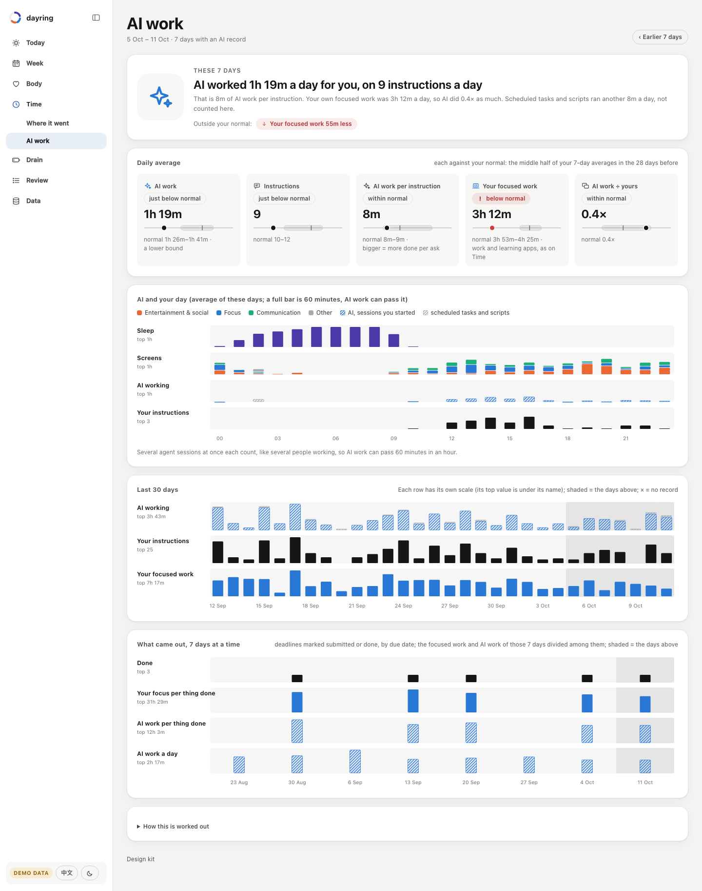

<div align="center">

# dayring

A local-first dashboard for your day: sleep, recovery, where the time goes and deadlines, each compared with your own normal.<br>
一个本地优先的个人看板：睡眠、恢复、时间去向和截止日期，每一项都和你自己的平常比。

**[Live demo · 在线演示](https://wannian001.github.io/dayring/)** (made-up data · 虚构数据) &nbsp;·&nbsp; [English](#english) &nbsp;·&nbsp; [中文](#中文)

</div>

## English


The ring at the top is one day on a 24-hour clock. The outer band is last night's sleep, the middle band is
today's calendar with the day's workouts in their own colour, and the inner bars are screen time for each hour,
coloured by what it was spent on. Everything below it answers one question: compared with my own last four
weeks, how am I doing today?

### What it shows

| Page | Question it answers |
|---|---|
| **Today** | Recovered as usual? (sleep, HRV and resting heart rate against the middle half of your previous 28 days) What is on today, and when should I be asleep tonight? What went on screens yesterday? What has tended to help the next day? |
| **Week** | Seven days of classes, deadlines and training, and how heavy the coming weeks are by share of grade. |
| **Body** · Weight | Weight as a 7-day average inside the corridor your plan allows, the weekly rate, and the long view. |
| **Body** · Sleep | 21 nights on one axis, last week against the week before, and an optional wake-time plan that moves the alarm earlier one step after each on-time morning. |
| **Time** | Where did the time go, and what changed? Sleep, workouts, calendar blocks and screens (phone, tablet and laptop counted once when they overlap), each measured from its own record and compared with your normal (a day with the middle half of the 28 days before it, the 7 days with your usual 7-day averages). The top names the biggest change, counted only when it is clearly outside your normal (say, more entertainment & social), not the biggest activity; each day gets an icon for its own change, or a check when it was a usual day, plus its screen and exercise minutes. Time no record covers is shown as not recorded. By hour, by app, over 30 days. **Devices at once** counts every device on its own instead: device time, screens at once (device time over clock time; 1.3× means using 1.3 screens at a time on average), the longest stretch on one thing, and each device by hour. An AI agent left working on the laptop while you are on your phone is not counted as you. Both can be named as what changed. |
| **Time** · AI work | How much did AI agents work for you, on how many instructions, next to your own focused work? Claude Code and Codex logs on this computer (times and counts only, never what was said): AI work a day, instructions, AI work per instruction and AI work over your own focus, each against your normal; AI and your day by the hour; and what came out, 7 days at a time (deadlines you marked done, and the focus and AI work each took). Usage is input, not output, so the AI numbers are never coloured better or worse. |
| **Drain** | What has been quietly wearing you down over the last 7 days? Seven signals (resting heart rate, HRV, the time you fall asleep, sleep-timing spread, screens in the hour before sleep, entertainment & social, app switching), each against your normal and, where you set one, your plan, plus whether short nights and hard training stacked up. No total score. |
| **Review** | One week of facts next to the four weeks before it. No scores, no judging. |
| **Data** | What arrived each day for 90 days, which files have unreadable rows, how to import more. |

<p>
  
  
</p>
<p>
  
  
</p>
<p>
  
  
</p>
<p>
  
  
</p>

English and Chinese, light and dark (it follows your system), phone and desktop. On a computer the menu is a sidebar on the left that folds to a column of icons; on a phone it is a tab bar at the bottom.

### How it decides what to say

- **You against you.** "Normal" is the 25th–75th percentile of your own previous 28 days, never a population
  norm. Two of three recovery signals worse than normal reads as "below your normal".
- **Missing stays missing.** An empty cell is unknown, not zero. A day that was not over when the data synced is
  shown but not compared. When a stream stops, every page says how old its numbers are. Waking time that no
  record covers is shown as not recorded, not shared out among the rest.
- **Associations, not causes.** "What has tended to help" compares the days after doing something with the days
  after not doing it, with 95% intervals and a Benjamini–Hochberg correction across the list. Only results that
  survive are coloured; the page says why you might train more on days you already feel good.
- **Colour means something.** Data colours follow the thing measured (focus is always blue, entertainment always
  orange, exercise always magenta) and were checked for colour-vision deficiency. Green and red are kept for
  "better" and "worse" and always come with a word.

### Design kit

Every page is built from one design kit: the colour tokens of both modes, the components, the SVG charts and the
icons, in four files (`css/tokens.css`, `css/kit.css`, `js/charts.js`, `js/icons.js`). The
**[gallery](https://wannian001.github.io/dayring/#kit)** shows all of them, each chart drawn from sample data
(it is not in the menu; every page links to it from its footer). Another app can take the kit with
`python3 -m dayring kit export DIR` and later see whether its copy is up to date, outdated or changed locally with
`python3 -m dayring kit check DIR`. How to use it, the colour rules and the versioning: [docs/DESIGN_KIT.md](docs/DESIGN_KIT.md).

### Quick start

Needs Python 3.9 or newer. No other packages.

```bash
git clone https://github.com/wannian001/dayring.git
cd dayring
python3 -m dayring serve --demo
```

Open <http://localhost:8790>. With your own data:

```bash
cp examples/dayring.example.toml dayring.toml     # timezone, plans, devices
python3 -m dayring import apple-health ~/Downloads/export.zip
python3 -m dayring import ics ~/Downloads/timetable.ics --kind class
python3 -m dayring import macos-screentime        # macOS only, experimental
python3 -m dayring import ai-logs                 # Claude Code and Codex: times and counts only
python3 -m dayring check                           # which rows could not be read
python3 -m dayring serve
```

The Apple Health export also holds your workouts with their start and end times (Apple Fitness and the Workout
app save them there), so the Time page can place exercise in the day next to sleep, classes and screens.

Deadlines, self-reports, workouts from another app and anything else are plain CSV files you can edit by hand or
map from another export (`python3 -m dayring import csv deadlines my-tracker.csv --map "Due=due,Task=title,Course=group"`).

### Your data stays on your computer

- Data lives in plain CSV files in a folder you choose ([format](docs/DATA_FORMAT.md)). Importers write them
  ([how each importer works](docs/IMPORTERS.md)); the dashboard only reads them.
- The server listens on `127.0.0.1`, has no write endpoints, and sends nothing anywhere.
- `build-static` (used for the demo site) refuses to run on your own data unless you pass a flag that says you
  mean to publish it.

### How it is built

```
importers ─▶ data/*.csv ─▶ store (checked against schema.py) ─▶ page modules ─▶ JSON ─▶ web app
 Apple Health, .ics,          one table per file,                today, week, body,     vanilla JS,
 Screen Time, any CSV         bad rows reported, not fatal       sleep, time, ...       hand-drawn SVG
```

- `dayring/schema.py` is the single definition of every table; `docs/DATA_FORMAT.md` is generated from it.
- Each page module returns numbers, units, bands and states, never sentences. The browser writes the words, which
  is why one payload reads in both languages (`dayring/web/js/i18n.js`).
- `python3 -m dayring page today` prints a page's JSON, so a script or an AI assistant can read the same numbers
  the page shows.
- The demo site is the same app with pre-rendered JSON (`python3 -m dayring build-static --demo`), served by
  GitHub Pages.
- Design notes: [docs/DESIGN.md](docs/DESIGN.md); the shared look is the design kit ([docs/DESIGN_KIT.md](docs/DESIGN_KIT.md), gallery at `#kit`).

### Development

```bash
python3 -m unittest discover -s tests      # runs on Python 3.9–3.13
python3 -m dayring page today --demo --today 2026-10-12
```

### Where it comes from

dayring is the public showcase of a personal system I use every day. My own version has more features and runs on
my real watch, phone and laptop data; it takes its look from the design kit here. This repository contains none of that data.

### License

[MIT](LICENSE)

---

## 中文


最上面的环是 24 小时的一天：外圈是昨晚的睡眠，中圈是今天的日程（当天的训练用它自己的颜色画在上面），内圈是每小时的屏幕时间，按用途上色。
下面所有内容都在回答一个问题：和我自己最近四周比，今天怎么样？

### 每一页回答什么

| 页面 | 回答的问题 |
|---|---|
| **今天** | 恢复得怎么样（睡眠、HRV、静息心率，各自和你之前 28 天的中间 50% 比）？今天要做什么，今晚几点放手机、几点睡？昨天屏幕时间花在哪了？做什么第二天会更好？ |
| **本周** | 七天的课、截止和训练；接下来几周按占成绩的比例看有多重。 |
| **身体** · 体重 | 体重 7 天平均是不是在计划允许的走廊里、每周降多少、长期走势。 |
| **身体** · 作息 | 21 晚画在同一根轴上，这周和上周比；可选的起床前移计划：每按时起一天，闹钟往前挪一步。 |
| **时间** | 时间都去哪了，和平常比变了什么？睡眠、训练、日程和屏幕（手机、平板、电脑同一时刻只算一次）各按自己的记录算，各自和你的平常比（单独一天和它之前 28 天的中间一半比，这 7 天和你平常的 7 天平均比）。最上面写的是明显超出平常的变化里最大的那一项（比如娱乐社交多了），而不是占得最多的那一项；每天一个图标标出当天的变化，平常的一天打个勾，下面写当天的屏幕时间和运动分钟。哪项记录都没覆盖的时间写成“没有记录”。按小时、按应用、最近 30 天。**几台同时用**则是每台设备各算各的：几台加起来的时间、叠加倍数（几台加起来 ÷ 钟表时间，1.3 倍就是平均同时用着 1.3 块屏幕）、最长一段只做一件事，以及每台设备按小时的分布。电脑上 AI 代理自己在干活、你在用手机的时间，不算成你的。这两项也会被写成“变了什么”。 |
| **时间** · AI 干活量 | AI 代理替你干了多少、你下了多少指令，和你自己专注做事放在一起看。读这台电脑上 Claude Code 和 Codex 的日志（只读时刻和条数，绝不读说了什么）：每天 AI 工时、指令条数、每条指令换来的工时、AI 对你自己专注的倍数，各和你的平常比；AI 和你的一天按小时排开；再按每 7 天看做成了什么（你标了完成的截止事项）、每件花了多少专注和 AI 工时。用量是投入不是产出，所以 AI 的几项不分好坏。 |
| **消耗** | 最近 7 天哪些东西在悄悄耗你？七个信号（静息心率、HRV、入睡时刻、作息波动、睡前一小时屏幕、娱乐和社交、应用切换），各自跟你的平常比，定了计划的再跟计划比；另外看这一周睡眠不足和高强度训练有没有叠在一起。不打总分。 |
| **复盘** | 一周的事实和之前四周并排。不打分，不评价。 |
| **数据** | 90 天里每天到了什么数据、哪些文件有读不出的行、怎么继续导入。 |

<p>
  
  
</p>
<p>
  
  
</p>
<p>
  
  
</p>

界面中英双语，浅色和深色（默认跟随系统），手机和电脑都能用。电脑上菜单是左边的侧栏，能收成一列图标；手机上是底部的标签栏。

### 它怎么判断

- **只和自己比。** “平常”是你自己之前 28 天的第 25–75 百分位，从不拿人群标准比。三项恢复指标里两项以上变差，就说“恢复低于平常”。
- **缺的就是缺。** 空格表示不知道，不当成 0。同步时还没过完的那天照样显示，但不跟平常比。某路数据停了，每一页都会写明数字是多久以前的。醒着却没有任何记录覆盖的时间写成“没有记录”，不摊到别的项目里。
- **是关联，不是因果。** “做什么第二天会更好”拿做了和没做的第二天比，给 95% 区间，整张表一起做 Benjamini–Hochberg 校正，只有校正后还成立的才上颜色；页面也写明为什么状态好的日子本来就更可能去练。
- **颜色有含义。** 数据颜色跟着被测的东西走（专注永远是蓝，娱乐永远是橙，运动永远是品红），做过色弱校验；绿和红只用来表示更好和更差，而且一定配文字。

### 设计套件

每一页都出自同一套设计套件：两种模式的颜色变量、组件、SVG 图表和图标，放在四个文件里（`css/tokens.css`、`css/kit.css`、`js/charts.js`、`js/icons.js`）。**[展示页](https://wannian001.github.io/dayring/#kit)**把它们全摆出来，每张图都用示例数据现场画（展示页不在菜单里，每一页底部都有链接）。别的应用可以用 `python3 -m dayring kit export DIR` 拷走这套文件，之后用 `python3 -m dayring kit check DIR` 查自己那份是最新、过期还是本地改过。怎么用、颜色规则和版本规则见 [docs/DESIGN_KIT.md](docs/DESIGN_KIT.md)。

### 快速开始

需要 Python 3.9 以上，不用装别的包。

```bash
git clone https://github.com/wannian001/dayring.git
cd dayring
python3 -m dayring serve --demo
```

打开 <http://localhost:8790>。换成你自己的数据：

```bash
cp examples/dayring.example.toml dayring.toml     # 时区、计划、设备
python3 -m dayring import apple-health ~/Downloads/export.zip
python3 -m dayring import ics ~/Downloads/timetable.ics --kind class
python3 -m dayring import macos-screentime        # 只限 macOS，试验性
python3 -m dayring import ai-logs                 # Claude Code 和 Codex：只读时刻和条数
python3 -m dayring check                           # 看哪些行读不出
python3 -m dayring serve
```

Apple 健康导出的数据里也有你的每次训练，带开始和结束时间（Apple Fitness 和“体能训练” App 记下的都在里面），所以时间页能把运动放进一天里，和睡眠、上课、屏幕排在一起。

截止日期、自评、别的 App 记的训练等其他数据都是普通 CSV，可以手改，也可以从别的导出文件映射过来
（`python3 -m dayring import csv deadlines my-tracker.csv --map "Due=due,Task=title,Course=group"`）。

### 数据只在你的电脑上

- 数据是你指定文件夹里的普通 CSV（[格式](docs/DATA_FORMAT.md)）。导入工具写它们（[每个导入工具怎么工作](docs/IMPORTERS.md)），看板只读。
- 服务只监听 `127.0.0.1`，没有写接口，不往任何地方发数据。
- `build-static`（演示站用的）遇到你自己的数据会拒绝运行，除非你加一个明确表示“我要公开”的参数。

### 怎么搭的

```
导入工具 ─▶ data/*.csv ─▶ 读取层（按 schema.py 检查）─▶ 各页计算 ─▶ JSON ─▶ 网页
Apple 健康、.ics、        一张表一个文件，              今天、本周、身体、      原生 JS，
屏幕使用时间、任意 CSV    坏行只报告、不中断            作息、时间……           手画 SVG
```

- `dayring/schema.py` 是所有表的唯一定义，`docs/DATA_FORMAT.md` 由它生成。
- 每页的计算只返回数字、单位、平常范围和状态，不返回句子；文字由浏览器写，所以同一份数据能切中英文（`dayring/web/js/i18n.js`）。
- `python3 -m dayring page today` 打出一页的 JSON，脚本或 AI 助手读到的数和页面上的一样。
- 演示站就是同一个网页加上预先算好的 JSON（`python3 -m dayring build-static --demo`），放在 GitHub Pages 上。
- 设计说明：[docs/DESIGN.md](docs/DESIGN.md)；共用的外观是设计套件（[docs/DESIGN_KIT.md](docs/DESIGN_KIT.md)，展示页在 `#kit`）。

### 开发

```bash
python3 -m unittest discover -s tests      # Python 3.9–3.13 都能跑
python3 -m dayring page today --demo --today 2026-10-12
```

### 来历

dayring 是我每天在用的个人系统的公开展示版。我自己那一版功能更多，用的是真实的手表、手机和电脑数据；它的外观来自这里的设计套件。这个仓库里没有任何那边的数据。

### 许可

[MIT](LICENSE)
