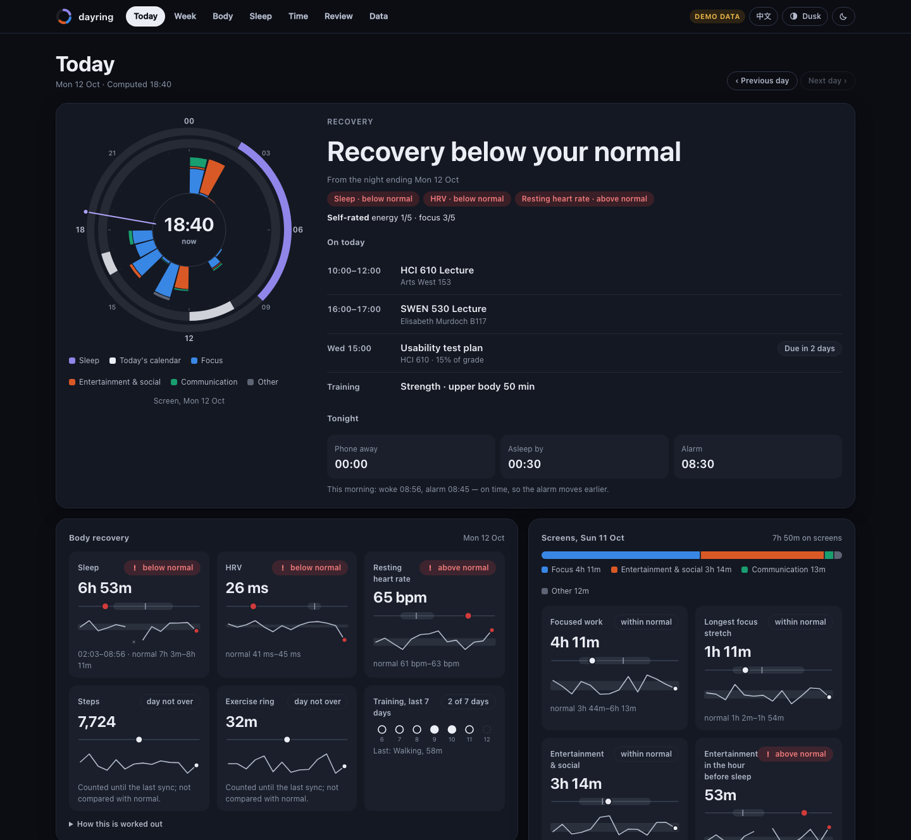
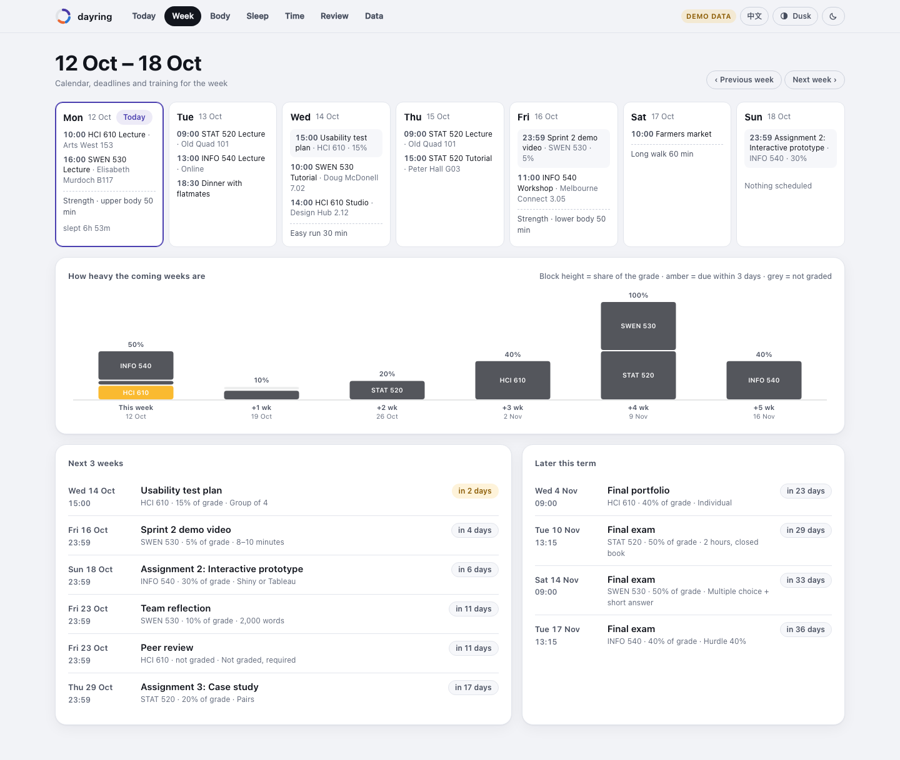
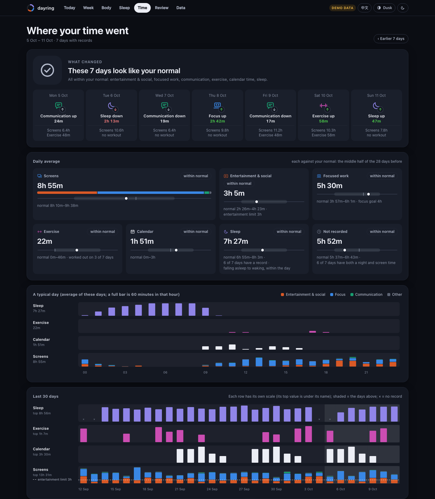
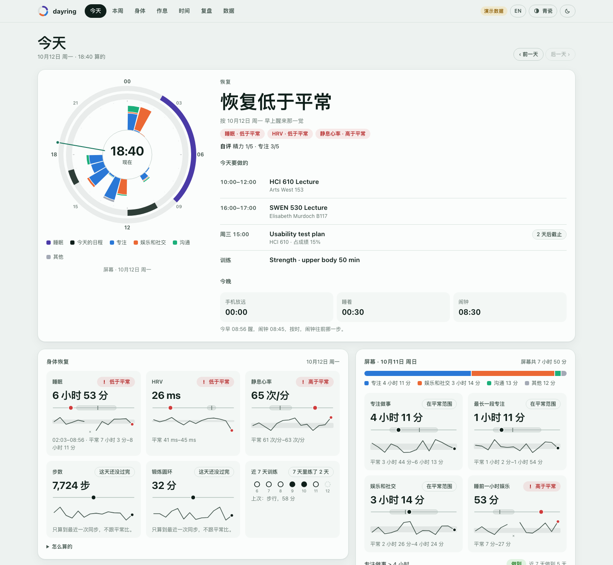
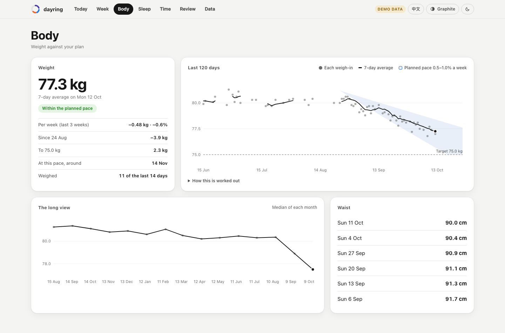

# dayring

A local-first dashboard for your day: sleep, recovery, where the time goes, and deadlines, each compared with your own normal.

**[Live demo](https://wannian001.github.io/dayring/)** (a made-up student, no real data) · [中文说明](README.zh-CN.md)



The ring at the top is one day on a 24-hour clock. The outer band is last night's sleep, the middle band is
today's calendar with the day's workouts in their own colour, and the inner bars are screen time for each hour,
coloured by what it was spent on. Everything below it answers one question: compared with my own last four
weeks, how am I doing today?

## What it shows

| Page | Question it answers |
|---|---|
| **Today** | Recovered as usual? (sleep, HRV and resting heart rate against the middle half of your previous 28 days) What is on today, and when should I be asleep tonight? What went on screens yesterday? What has tended to help the next day? |
| **Week** | Seven days of classes, deadlines and training, and how heavy the coming weeks are by share of grade. |
| **Body** | Weight as a 7-day average inside the corridor your plan allows, the weekly rate, and the long view. |
| **Sleep** | 21 nights on one axis, last week against the week before, and an optional wake-time plan that moves the alarm earlier one step after each on-time morning. |
| **Time** | Where did the time go, and what changed? Sleep, workouts, calendar blocks and screens (phone, tablet and laptop counted once when they overlap), each measured from its own record and compared with your normal (the middle half of the 28 days before). The top names what moved furthest from normal (say, more entertainment & social), not the biggest activity, and each day gets an icon for its own change plus its screen and exercise minutes. Time no record covers is shown as not recorded. By hour, by app, over 30 days. |
| **Review** | One week of facts next to the four weeks before it. No scores, no judging. |
| **Data** | What arrived each day for 90 days, which files have unreadable rows, how to import more. |

<p>
  
  
</p>
<p>
  
  
</p>

English and Chinese, three themes (dusk, graphite, celadon), light and dark, phone and desktop.

## How it decides what to say

- **You against you.** "Normal" is the 25th–75th percentile of your own previous 28 days, never a population
  norm. Two of three recovery signals worse than normal reads as "below your normal".
- **Missing stays missing.** An empty cell is unknown, not zero. A day that was not over when the data synced is
  shown but not compared. When a stream stops, every page says how old its numbers are. Waking time that no
  record covers is shown as not recorded, not shared out among the rest.
- **Associations, not causes.** "What has tended to help" compares the days after doing something with the days
  after not doing it, with 95% intervals and a Benjamini–Hochberg correction across the list. Only results that
  survive are coloured; the page says why you might train more on days you already feel good.
- **Colour means something.** Data colours follow the thing measured (focus is always blue, entertainment always
  orange, exercise always magenta) and were checked for colour-vision deficiency. Green and red are kept for
  "better" and "worse" and always come with a word.

## Quick start

Needs Python 3.9 or newer. No other packages.

```bash
git clone https://github.com/wannian001/dayring.git
cd dayring
python3 -m dayring serve --demo
```

Open <http://localhost:8790>. With your own data:

```bash
cp examples/dayring.example.toml dayring.toml     # timezone, plans, devices
python3 -m dayring import apple-health ~/Downloads/export.zip
python3 -m dayring import ics ~/Downloads/timetable.ics --kind class
python3 -m dayring import macos-screentime        # macOS only, experimental
python3 -m dayring check                           # which rows could not be read
python3 -m dayring serve
```

The Apple Health export also holds your workouts with their start and end times (Apple Fitness and the Workout
app save them there), so the Time page can place exercise in the day next to sleep, classes and screens.

Deadlines, self-reports, workouts from another app and anything else are plain CSV files you can edit by hand or
map from another export (`python3 -m dayring import csv deadlines my-tracker.csv --map "Due=due,Task=title,Course=group"`).

## Your data stays on your computer

- Data lives in plain CSV files in a folder you choose ([format](docs/DATA_FORMAT.md)). Importers write them
  ([how each importer works](docs/IMPORTERS.md)); the dashboard only reads them.
- The server listens on `127.0.0.1`, has no write endpoints, and sends nothing anywhere.
- `build-static` (used for the demo site) refuses to run on your own data unless you pass a flag that says you
  mean to publish it.

## How it is built

```
importers ─▶ data/*.csv ─▶ store (checked against schema.py) ─▶ page modules ─▶ JSON ─▶ web app
 Apple Health, .ics,          one table per file,                today, week, body,     vanilla JS,
 Screen Time, any CSV         bad rows reported, not fatal       sleep, time, ...       hand-drawn SVG
```

- `dayring/schema.py` is the single definition of every table; `docs/DATA_FORMAT.md` is generated from it.
- Each page module returns numbers, units, bands and states, never sentences. The browser writes the words, which
  is why one payload reads in both languages (`dayring/web/js/i18n.js`).
- `python3 -m dayring page today` prints a page's JSON, so a script or an AI assistant can read the same numbers
  the page shows.
- The demo site is the same app with pre-rendered JSON (`python3 -m dayring build-static --demo`), served by
  GitHub Pages.
- Design notes: [docs/DESIGN.md](docs/DESIGN.md).

## Development

```bash
python3 -m unittest discover -s tests      # runs on Python 3.9–3.13
python3 -m dayring page today --demo --today 2026-10-12
```

## Where it comes from

dayring is the public, generic core of a personal system I use every day. The private version reads
my own watch, phone and laptop data and runs this same interface; this repository contains none of that data.

## License

[MIT](LICENSE)
