<div align="center">

# Proactive Health AIO · 主动健康管理 AIO

Proactive health management, all in one, on your own computer: sleep, exercise, food, weight, screens and your plans
in one place, each compared with your own normal, and every morning, what to adjust today and why.<br>
一站式的主动健康管理，跑在你自己的电脑上：睡眠、运动、饮食、体重、屏幕和计划放在一处，每一项都和你自己的平常比；每天早上告诉你今天该调整什么、为什么。

**[Live demo · 在线演示](https://wannian001.github.io/proactive-health-aio/)** (made-up data · 虚构数据) &nbsp;·&nbsp; [English](#english) &nbsp;·&nbsp; [中文](#中文)

</div>

## English


### Why it exists

| | |
|---|---|
| **Today** | Your health data is already being collected, in pieces: the watch has sleep, HRV, resting heart rate and workouts; a food app has your meals; Screen Time has your phone; the calendar has the week's load. |
| **The problem** | Each app answers its own question, against a population norm or its own score, and only when you go and look. Nothing puts "slept 6 hours, ate late three nights running, strength training planned for today" side by side and says what to change today. So most people use health data *reactively*: they look after they already feel bad. |
| **What makes it hard** | The signals have different units and different strength of evidence. Logs have gaps (a day you did not log food is not a day you ate nothing). Associations in one person's data are not causes. And this is the most private data you have. |
| **What people use now** | Wearable apps (Oura, WHOOP, Garmin Connect) turn their own device's data into a recovery score. Food loggers (MyFitnessPal, Cronometer) cover food. Screen Time covers screens. Apple Health stores almost everything but explains little. Cross-app trackers (Exist.io, Bearable) look for correlations between apps. |
| **What that costs you** | Several apps and often several subscriptions; your history in several clouds; scores whose formula you cannot check; and you still do the joining-up yourself. |
| **What this does instead** | One local app reads the exports you already have, compares every signal with *your own* last 28 days (not a population), keeps every goal in one file, and each morning names at most three things to adjust (one each for training, sleep and food) with the numbers behind each. Every rule is written down; nothing leaves the computer. |
| **Trade-offs, on purpose** | No live sync: you import an Apple Health export (an iPhone companion is future work). Food needs a logging app that writes to Apple Health, or a CSV. The advice is a short list of fixed, explainable rules, not a model; it is about habits, not medical advice. A missing number stays missing, so a sparse log gives fewer answers, not made-up ones. |

### The loop it runs

**Measure** (import what your devices already record) → **compare** (each signal against your own normal and your plan) → **adjust** (today's three things) → **keep track** (goals, kept on how many days) → **review** (the week next to the four before it).

| Menu | Page | Question it answers |
|---|---|---|
| **Today** | | One card for the morning: the day ring, how recovered you are against your own last 28 days, today's training and calendar in a line, when to be asleep tonight, and **what to adjust today** (at most one thing each for training, sleep and food, with the reason in a few words). Under it, every other part in one line with its number and state (sleep, HRV, resting heart rate, the week's exercise, food, screens, drain, weight, what helps you); a line opens its page. |
| **Body** | Sleep | Tonight's times and how far the alarm plan has come; the last 7 nights against the 7 before; 21 nights on one axis and, in a tab, the alarm ladder (one step earlier after each on-time morning). Night-by-night checks are on Goals. |
| | Exercise | This week against the weekly goal (your plan, or the WHO guideline of 150 active minutes and 2 strength days, and it says which), day by day with the training planned for the days to come; the last 7 days against your normal; training load against recovery; 12 weeks by kind (strength, cardio, walking); how HRV and resting heart rate tend to answer each kind the next morning. |
| | Food | The last 7 logged days against your normal and your plan: energy, protein (per kg of your weight), fibre, and the hours from the last meal to falling asleep; 14 days of meals by time of day with the hours before sleep striped; the food log set against the scale (the weekly change the log implies against the one the scale shows); what an early dinner has gone with the next morning. |
| | Weight | Weight as a 7-day average inside the corridor your plan allows, the weekly rate, and the long view. |
| **Time & energy** | Where it went | Where did the time go, and what changed? Sleep, workouts, calendar and screens (phone, tablet and laptop counted once when they overlap), each against your normal; the biggest change clearly outside your normal is named, not the biggest activity. **Devices at once** counts every device on its own: screens at once, the longest stretch on one thing, each device by the hour. **Stimulation and focus, averaged**: 90 days of entertainment & social minutes and of the longest focus stretch, each as a 7-day average against your normal, the last 28 days next to the 28 before them. What people call “dopamine tolerance” can't be measured by a phone or a watch, so the card shows the behaviour, never a dopamine number. The page is two cards: what changed with the daily averages, then the detail in tabs (a typical day, 30 days, stimulation and focus, devices at once, top apps). |
| | AI work | How much AI agents worked for you, on how many instructions, next to your own focused work (Claude Code and Codex logs on this computer: times and counts only, never what was said). Usage is input, not output, so it is never coloured better or worse. |
| | Drain | What has been quietly wearing you down over 7 days? Seven signals (resting heart rate, HRV, the time you fall asleep, sleep-timing spread, screens before sleep, entertainment & social, app switching), each against your normal and your plan, plus whether short nights and hard training stacked up. No total score. |
| **Goals & schedule** | Goals | Every plan in one place: sleep, exercise, food, weight, screens, each with the last 28 days as kept / not kept / no record, counted as "n of the days with a record" (never a streak, never a score). **Set or change any goal right on the page**; a goal not set yet is listed with a button to set it. An assistant's proposals wait at the top until you accept or decline them. |
| | Schedule | Seven days of classes, deadlines and training, and how heavy the coming weeks are by share of grade. |
| **Weekly review** | | One week of facts next to the four weeks before it, food and activity included, and **what has tended to help the next day** (the next morning's HRV, resting heart rate and energy after doing something against not doing it, with 95% intervals). No scores, no judging. |
| **Data sources** | | What arrived each day for 90 days (sleep, HRV, steps, weight, screens, food log, …), which files have unreadable rows, how to import more. |
| *About this project* | Overview | What it is, who it is for, the problem it answers, how it compares with what people use now, the trade-offs and what comes next. |
| | Guide | How to use it: look around the demo, install it, bring in your Apple Health export, set your goals, and what to open each day. |
| | [History ↗](https://tangjiakuo.top/demo/aio-history/en/) | Where this project comes from: the personal system it was taken out of, over a year and four generations, what each one found and what changed. It quotes that personal system, so it lives on the author's own site; the menu links out to it. |

<p>
  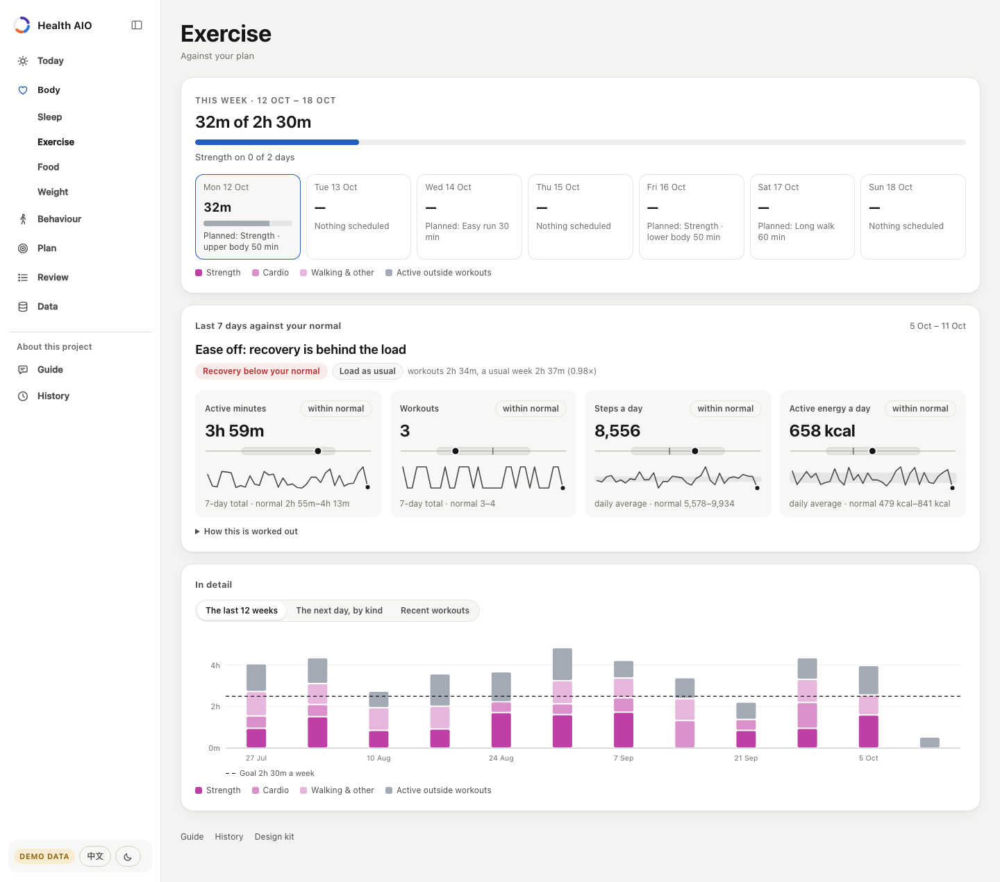
  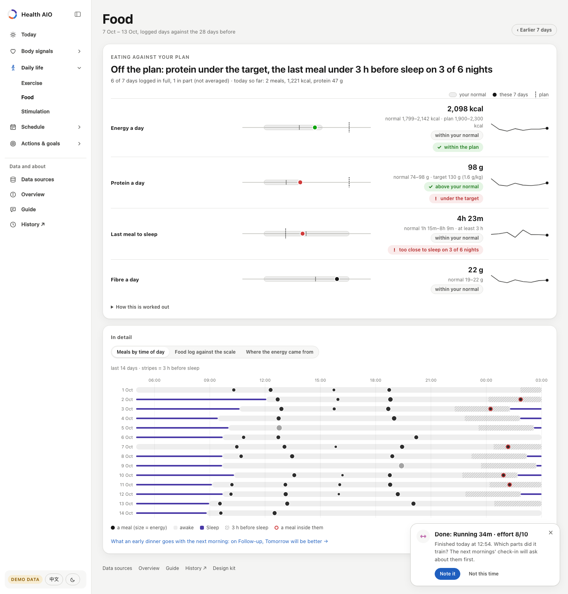
</p>
<p>
  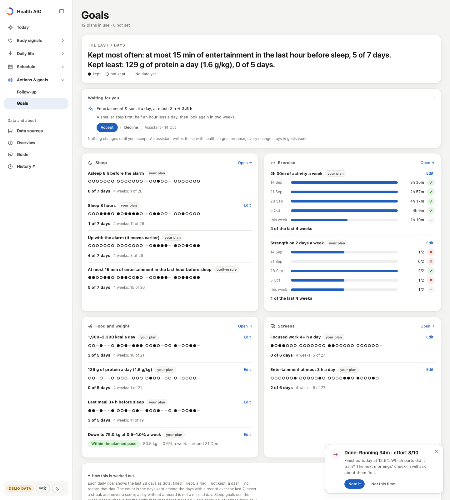
  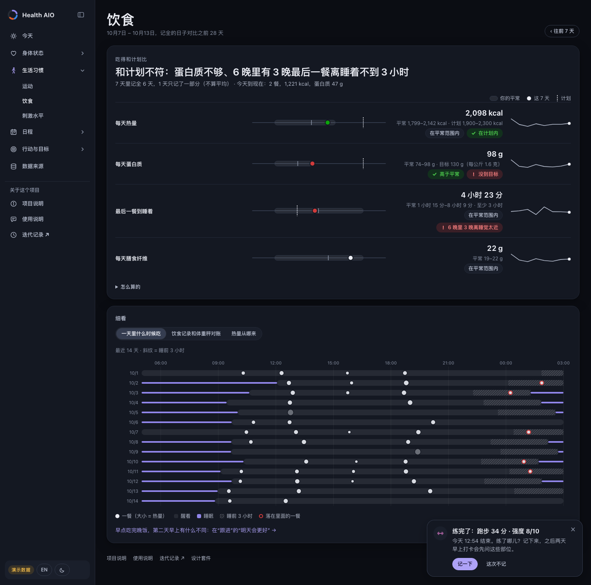
</p>
<p>
  
  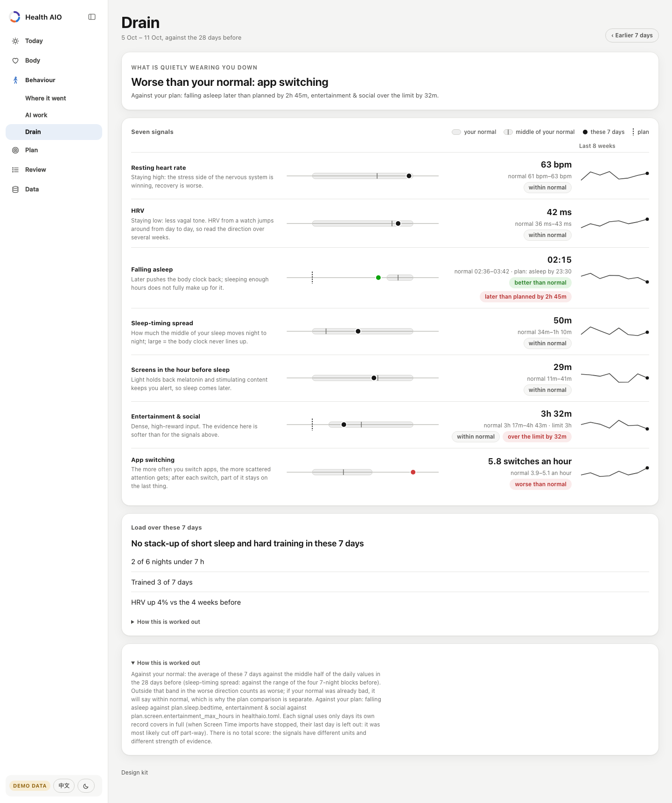
</p>

English and Chinese, light and dark (it follows your system), phone and desktop. On a computer the menu is a sidebar
on the left that folds to a column of icons; on a phone it is a tab bar at the bottom. Overview, Guide and a link to History sit under the menu (on a phone, small icons in the top row).

### How it decides what to say

- **You against you.** "Normal" is the 25th–75th percentile of your own previous 28 days, never a population norm.
  Two of three recovery signals worse than normal reads as "below your normal". The one place a population number
  appears is the WHO activity guideline, used only when you have set no exercise plan, and labelled as such.
- **Today's adjustments are rules you can read.** Recovery below normal with training planned → take it easy;
  a short night → tonight's time to be asleep by; late last meals on two or more of the last 7 logged nights → when to
  finish dinner; and so on (the full list is in `healthaio/modules/actions.py` and on the page). At most one each for
  training, sleep and food; nothing off means "a steady day", never invented advice.
- **Missing stays missing.** An empty cell is unknown, not zero. A day with fewer than two main meals logged is shown
  but not averaged; a day not logged at all is not a day of eating nothing. A day that was not over when the data
  synced is shown but not compared. When a stream stops, every page says how old its numbers are.
- **Associations, not causes.** "What has tended to help" compares the days after doing something with the days after
  not doing it, with 95% intervals and a Benjamini–Hochberg correction across the list. Only results that survive are
  coloured; the page says why you might train more on days you already feel good.
- **Colour means something.** Data colours follow the thing measured (focus is always blue, entertainment always
  orange, exercise always magenta, with lighter steps of it for kinds of training) and were checked for colour-vision
  deficiency. Green and red are kept for "better" and "worse" and always come with a word.

### Design kit

Every page is built from one design kit: the colour tokens of both modes, the components, the SVG charts and the
icons, in four files (`css/tokens.css`, `css/kit.css`, `js/charts.js`, `js/icons.js`). The
**[gallery](https://wannian001.github.io/proactive-health-aio/#kit)** shows all of them, each chart drawn from sample data
(it is not in the menu; every page links to it from its footer). Another app can take the kit with
`python3 -m healthaio kit export DIR` and later see whether its copy is up to date, outdated or changed locally with
`python3 -m healthaio kit check DIR`. How to use it, the colour rules and the versioning: [docs/DESIGN_KIT.md](docs/DESIGN_KIT.md).

### Quick start

Needs Python 3.9 or newer. No other packages.

```bash
git clone https://github.com/wannian001/proactive-health-aio.git
cd proactive-health-aio
python3 -m healthaio serve --demo
```

Open <http://localhost:8790>. With your own data:

```bash
cp examples/healthaio.example.toml healthaio.toml     # timezone, plans (sleep, exercise, food, weight, screens), devices
python3 -m healthaio import apple-health ~/Downloads/export.zip
python3 -m healthaio import ics ~/Downloads/timetable.ics --kind class
python3 -m healthaio import macos-screentime        # macOS only, experimental
python3 -m healthaio import ai-logs                 # Claude Code and Codex: times and counts only
python3 -m healthaio check                           # which rows could not be read
python3 -m healthaio serve
```

One Apple Health export brings in most of it: sleep, HRV, resting heart rate, steps, the Activity ring, energy burned,
weight, every workout with its times and average heart rate, and the meals that food-logging apps (MyFitnessPal,
Lose It!, Cronometer and others) write into Health. Deadlines, self-reports and anything else are plain CSV files you
can edit by hand or map from another export
(`python3 -m healthaio import csv meals my-food-log.csv --map "Date=time,Meal=meal,Calories=kcal,Protein=protein_g"`).

### Goals, and where an assistant plugs in

Set goals on the Goals page, or from the command line. Either way the change is a line in `goals.jsonl` next to
`healthaio.toml`, laid over the file (which stays as you wrote it), so the log is also the history of every change.
An assistant (any agent that can run a command) reads the pages as JSON and proposes; nothing changes until you
accept, on the Goals page or here:

```bash
python3 -m healthaio page goals                       # every goal and how often it was kept, as JSON
python3 -m healthaio goal propose screen.entertainment_max_hours 2.5 --note "A smaller step first"
python3 -m healthaio goal list                        # values now, where each comes from, open proposals
python3 -m healthaio goal accept <id>                 # or decline <id>; set FIELD VALUE to set one yourself
```

### Your data stays on your computer

- Data lives in plain CSV files in a folder you choose ([format](docs/DATA_FORMAT.md)). Importers write them
  ([how each importer works](docs/IMPORTERS.md)); the dashboard only reads them.
- The server listens on `127.0.0.1` and sends nothing anywhere. The one thing it writes is a goal you set on the Goals
  page: a line in `goals.jsonl` next to `healthaio.toml`, accepted only from the app's own page.
- `build-static` (used for the demo site) refuses to run on your own data unless you pass a flag that says you mean to
  publish it.

### How it is built

```
importers ─▶ data/*.csv ─▶ store (checked against schema.py) ─▶ page modules ─▶ JSON ─▶ web app
 Apple Health, .ics,          one table per file,                today, exercise, food,   vanilla JS,
 Screen Time, any CSV         bad rows reported, not fatal       goals, sleep, time, ...  hand-drawn SVG
```

- `healthaio/schema.py` is the single definition of every table; `docs/DATA_FORMAT.md` is generated from it.
- Each page module returns numbers, units, bands and states, never sentences. The browser writes the words, which is
  why one payload reads in both languages (`healthaio/web/js/i18n.js`).
- `python3 -m healthaio page today` prints a page's JSON (today's adjustments included), so a script or an AI
  assistant can read the same numbers the page shows.
- The demo site is the same app with pre-rendered JSON (`python3 -m healthaio build-static --demo`), served by GitHub
  Pages. The demo person, Sam, is made up: a graduate student with a night-owl sleep, a weight plan, a food log with
  late snacks before deadlines, and the screen habits of most students.
- Design notes: [docs/DESIGN.md](docs/DESIGN.md); the shared look is the design kit ([docs/DESIGN_KIT.md](docs/DESIGN_KIT.md), gallery at `#kit`).

### Development

```bash
python3 -m unittest discover -s tests      # runs on Python 3.9–3.13
python3 -m healthaio page food --demo --today 2026-10-12
```

### Not medical advice

This is a tool for noticing patterns in your own habits. It does not diagnose anything, and its suggestions are
everyday habits (sleep earlier, eat earlier, train lighter). For anything about your health, talk to a professional.

### Where it comes from

This project started as *dayring*, the public showcase of a personal system I use every day; the day ring at the top
of Today is where the old name came from, and links to the old repository still redirect here. My own version has
more features and runs on my real watch, phone and laptop data; it takes its look from the design kit here. This
repository contains none of that data.

### License

[MIT](LICENSE)

---

## 中文

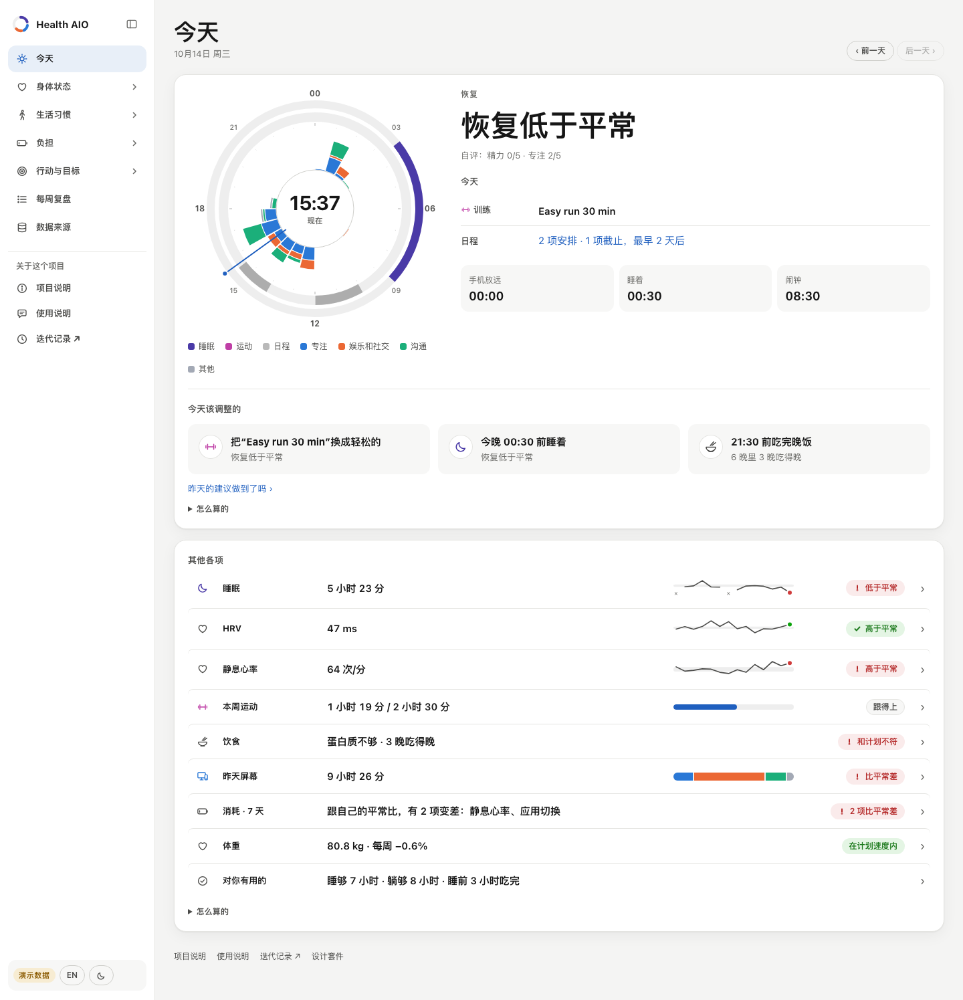

### 为什么做这个

| | |
|---|---|
| **现状** | 你的健康数据其实已经在被记录，只是散在各处：手表里有睡眠、HRV、静息心率和训练；饮食 App 里有每一餐；屏幕使用时间里有手机；日历里有这周有多忙。 |
| **问题** | 每个 App 只回答自己那一个问题，拿人群标准或者它自己的分数来比，而且要你自己点进去看。没有谁会把“只睡了 6 小时、连续三晚吃得晚、今天又排了力量训练”放在一起，告诉你今天该改什么。所以大多数人用健康数据是**被动**的：已经不舒服了才去看。 |
| **难在哪** | 各种信号单位不同、证据强弱不同；记录有缺口（某天没记饮食，不等于那天没吃东西）；一个人数据里的关联不是因果；而且这是你最私密的数据。 |
| **现在大家用什么** | 穿戴设备的 App（Oura、WHOOP、Garmin Connect）把自家设备的数据算成一个恢复分；记饮食的 App（MyFitnessPal、薄荷健康、Cronometer）只管吃；屏幕使用时间只管屏幕；Apple 健康几乎什么都存，但很少解释；跨 App 的追踪工具（Exist.io、Bearable）在不同 App 之间找相关。 |
| **它们带来的负担** | 好几个 App、往往还有好几份订阅；你的历史散在好几家云上；分数怎么算的你查不到；最后把这些拼起来的还是你自己。 |
| **这里的做法** | 一个本地的 App 读你手上已有的导出数据，每个信号都和**你自己**最近 28 天比（不和人群比），所有目标写在一个文件里；每天早上最多点出三件该调整的事（训练、睡眠、饮食各一件），每件都写明依据的数字。每条规则都写在明处，数据不出这台电脑。 |
| **有意做的取舍** | 不实时同步：要导入一次 Apple 健康的导出包（iPhone 配套 App 是以后的事）。饮食要靠一个会写进 Apple 健康的记录 App，或者一份 CSV。建议是一小组固定、讲得清的规则，不是模型；管的是生活习惯，不是医疗建议。缺的数就是缺，记得少，得到的回答就少，而不是编出来的回答。 |

### 它跑的闭环

**记录**（导入设备已经记下的）→ **对比**（每个信号对比你自己的平常、对比你的计划）→ **调整**（今天的三件事）→ **跟踪**（每个目标做到了几天）→ **复盘**（这一周和之前四周并排）。

| 菜单 | 页面 | 回答的问题 |
|---|---|---|
| **今天** | | 早上看的一张卡：一天的环、恢复和你自己最近 28 天比怎么样、今天的训练和日程一行、今晚几点睡着，以及**今天该调整的**（训练、睡眠、饮食各最多一件，原因几个字说清）。下面是其他各项，一项一行，只写数字和状态（睡眠、HRV、静息心率、本周运动、饮食、屏幕、消耗、体重、对你有用的），点一行进它的页面。 |
| **身体** | 作息 | 今晚几点睡、闹钟前移计划走到哪了；最近 7 晚和再往前 7 晚比；21 晚画在同一根轴上，另一个标签是闹钟台阶（每按时起一天，闹钟往前挪一步）。每晚的打勾在目标页。 |
| | 运动 | 本周对照每周目标（你的计划，没设就用世卫组织建议的每周 150 分钟活动、2 天力量训练，并写明用的是哪个），一天一格，还没到的日子写着计划的训练；最近 7 天对比平常；训练负荷对照恢复；12 周按种类（力量、有氧、步行）；每种训练后第二天早上的 HRV 和静息心率通常怎么样。 |
| | 饮食 | 最近 7 天里记全的日子对比平常、对比计划：热量、蛋白质（按体重每公斤算）、膳食纤维、最后一餐到睡着隔了几小时；最近 14 天每一餐在一天里的时刻，睡前几小时画斜纹；饮食记录和体重秤对账（按记录该每周变多少、秤上实际变多少）；早点吃完晚饭的第二天早上有什么不同。 |
| | 体重 | 体重 7 天平均是不是在计划允许的走廊里、每周降多少、长期走势。 |
| **时间与精力** | 去向 | 时间都去哪了，和平常比变了什么？睡眠、训练、日程和屏幕（手机、平板、电脑同一时刻只算一次）各自和平常比；写出的是明显超出平常的变化里最大的那一项，而不是占得最多的那一项。**几台同时用**：每台设备各算各的，叠加倍数、最长一段只做一件事、每台设备按小时。**刺激均线 · 专注均线**：90 天里每天的娱乐社交时长和最长一段专注，各画成 7 天平均、对着你的平常，并把最近 28 天和再之前 28 天并排。常说的“多巴胺阈值”手机和手表测不了，所以这里只摆行为，不出现多巴胺的数。整页两张卡：变了什么和每天平均，其余放在标签里（典型的一天、最近 30 天、刺激和专注、几台同时用、常用应用）。 |
| | AI 干活量 | AI 代理替你干了多少、你下了多少指令，和你自己专注做事放在一起看（读这台电脑上 Claude Code 和 Codex 的日志：只读时刻和条数，绝不读说了什么）。用量是投入不是产出，所以不分好坏。 |
| | 消耗 | 最近 7 天哪些东西在悄悄耗你？七个信号（静息心率、HRV、入睡时刻、作息波动、睡前屏幕、娱乐和社交、应用切换），各自和平常比、和计划比；另外看睡眠不足和高强度训练有没有叠在一起。不打总分。 |
| **目标与日程** | 目标 | 所有计划放在一处：睡眠、运动、饮食、体重、屏幕，每个目标把最近 28 天画成做到 / 没做到 / 没记录，计数写成“有记录的日子里做到几天”（不算连续天数，也不打分）。**目标可以直接在页面上设、随时改**；没设的目标列出来，旁边有“设一个”。AI 助手提的建议放在最上面，你采纳或不要之前什么都不变。 |
| | 日程 | 七天的课、截止和训练；接下来几周按占成绩的比例看有多重。 |
| **每周复盘** | | 一周的事实和之前四周并排，饮食和活动也在里面；还有**做什么第二天会更好**（做了和没做的日子比第二天早上的 HRV、静息心率和精力，带 95% 区间）。不打分，不评价。 |
| **数据来源** | | 90 天里每天到了什么数据（睡眠、HRV、步数、体重、屏幕、饮食记录……）、哪些文件有读不出的行、怎么继续导入。 |
| *关于这个项目* | 项目说明 | 它是什么、为谁做、解决什么问题、和现在常用的比、有意的取舍、接下来做什么。 |
| | 使用说明 | 怎么用：先看演示，装到自己电脑上，导入 Apple 健康的导出包，设目标，以及每天该看哪里。 |
| | [迭代记录 ↗](https://tangjiakuo.top/demo/aio-history/) | 这个项目的来历：它是从作者自己用了一年的个人系统里抽出来的；那个系统换了四代，每一代发现了什么、改了什么。它引了那个个人系统里的内容，所以放在作者自己的网站上，菜单里是一个指过去的链接。 |

<p>
  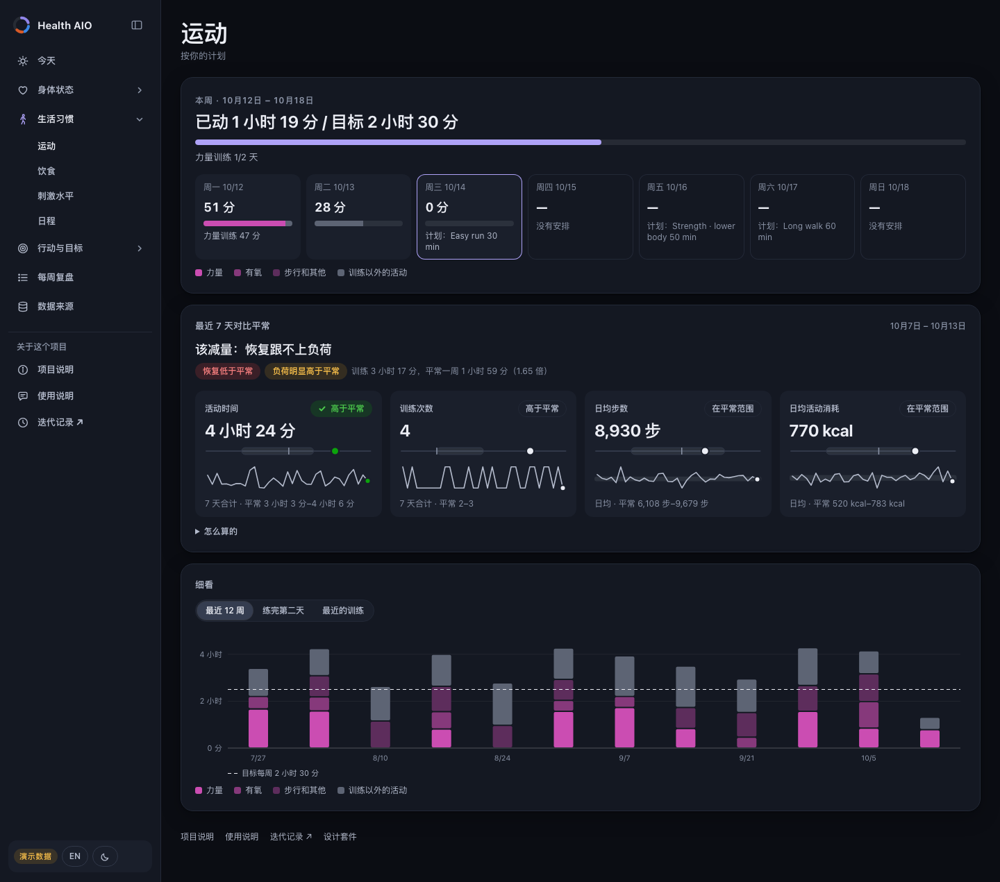
  
</p>
<p>
  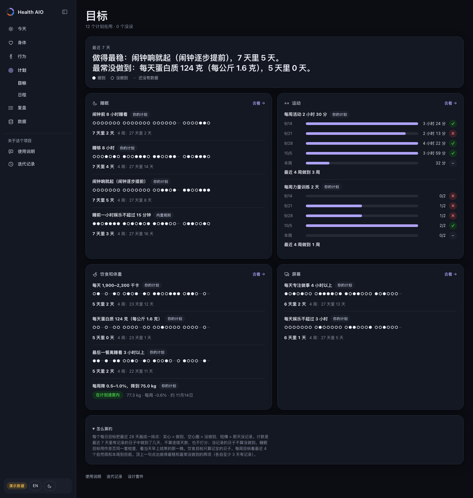
  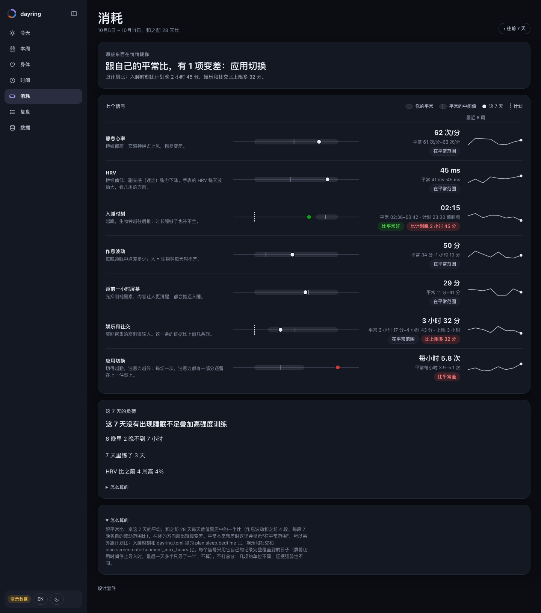
</p>
<p>
  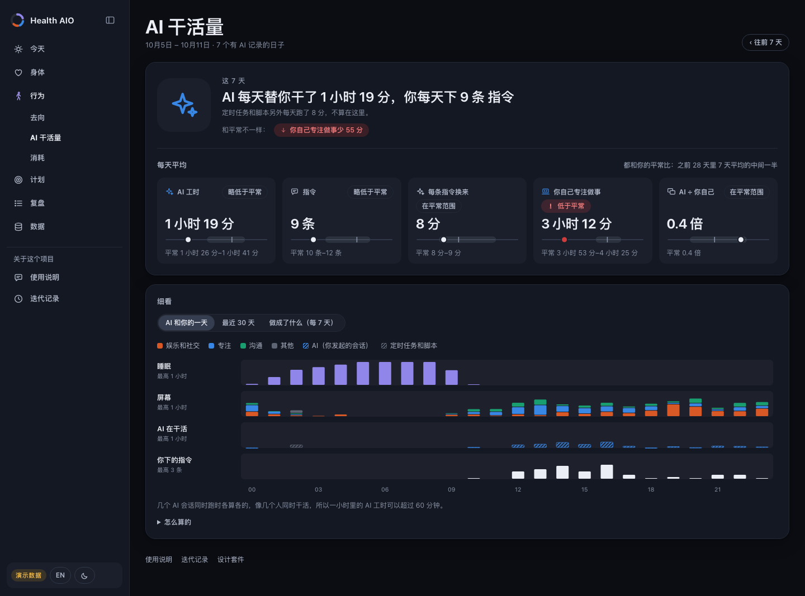
  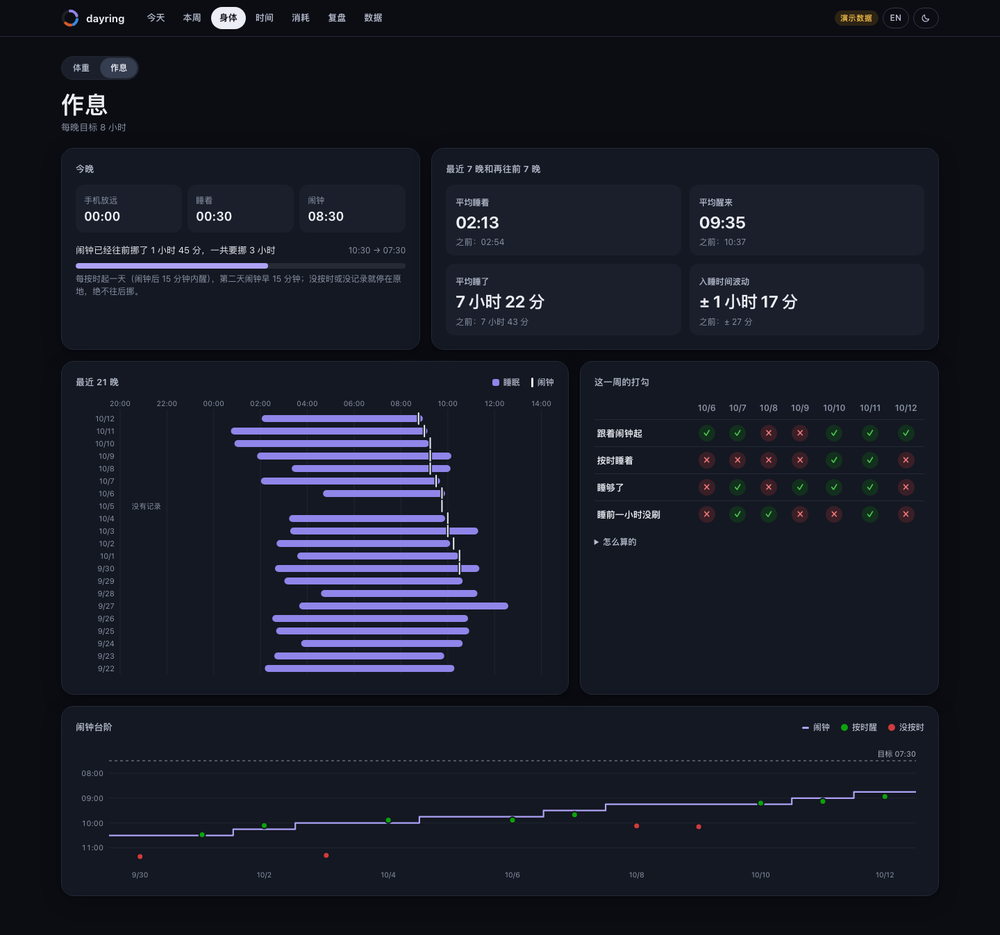
</p>

界面中英双语，浅色和深色（默认跟随系统），手机和电脑都能用。电脑上菜单是左边的侧栏，能收成一列图标；手机上是底部的标签栏。项目说明、使用说明和迭代记录的链接在菜单下面（手机上是顶栏的小图标）。

### 它怎么判断

- **只和自己比。** “平常”是你自己之前 28 天的第 25–75 百分位，从不拿人群标准比。三项恢复指标里两项以上变差，就说“恢复低于平常”。唯一出现人群数字的地方是世卫组织的活动建议，只在你没设运动计划时用，而且标明了出处。
- **今天的调整是看得懂的规则。** 恢复低于平常、今天又排了训练 → 放轻松；昨晚睡少了 → 今晚几点前睡着；最近 7 个记全的晚上有 2 晚以上最后一餐离睡觉太近 → 几点前吃完晚饭；等等（完整列表在 `healthaio/modules/actions.py` 和页面上）。训练、睡眠、饮食各最多一件；没有偏离就写“照计划来”，绝不编建议。
- **缺的就是缺。** 空格表示不知道，不当成 0。一天记了不到两顿正餐，照样显示但不算平均；一天完全没记，不等于那天没吃。同步时还没过完的那天照样显示，但不跟平常比。某路数据停了，每一页都会写明数字是多久以前的。
- **是关联，不是因果。** “做什么第二天会更好”拿做了和没做的第二天比，给 95% 区间，整张表一起做 Benjamini–Hochberg 校正，只有校正后还成立的才上颜色；页面也写明为什么状态好的日子本来就更可能去练。
- **颜色有含义。** 数据颜色跟着被测的东西走（专注永远是蓝，娱乐永远是橙，运动永远是品红，训练种类用它的浅几档来分），做过色弱校验；绿和红只用来表示更好和更差，而且一定配文字。

### 设计套件

每一页都出自同一套设计套件：两种模式的颜色变量、组件、SVG 图表和图标，放在四个文件里（`css/tokens.css`、`css/kit.css`、`js/charts.js`、`js/icons.js`）。**[展示页](https://wannian001.github.io/proactive-health-aio/#kit)**把它们全摆出来，每张图都用示例数据现场画（展示页不在菜单里，每一页底部都有链接）。别的应用可以用 `python3 -m healthaio kit export DIR` 拷走这套文件，之后用 `python3 -m healthaio kit check DIR` 查自己那份是最新、过期还是本地改过。怎么用、颜色规则和版本规则见 [docs/DESIGN_KIT.md](docs/DESIGN_KIT.md)。

### 快速开始

需要 Python 3.9 以上，不用装别的包。

```bash
git clone https://github.com/wannian001/proactive-health-aio.git
cd proactive-health-aio
python3 -m healthaio serve --demo
```

打开 <http://localhost:8790>。换成你自己的数据：

```bash
cp examples/healthaio.example.toml healthaio.toml     # 时区、计划（睡眠、运动、饮食、体重、屏幕）、设备
python3 -m healthaio import apple-health ~/Downloads/export.zip
python3 -m healthaio import ics ~/Downloads/timetable.ics --kind class
python3 -m healthaio import macos-screentime        # 只限 macOS，试验性
python3 -m healthaio import ai-logs                 # Claude Code 和 Codex：只读时刻和条数
python3 -m healthaio check                           # 看哪些行读不出
python3 -m healthaio serve
```

一个 Apple 健康导出包就能带进来大部分：睡眠、HRV、静息心率、步数、活动圆环、消耗的热量、体重、每次训练（带起止时间和平均心率），以及记饮食的 App（MyFitnessPal、Lose It!、Cronometer 等）写进健康里的每一餐。截止日期、自评等其他数据都是普通 CSV，可以手改，也可以从别的导出文件映射过来
（`python3 -m healthaio import csv meals my-food-log.csv --map "Date=time,Meal=meal,Calories=kcal,Protein=protein_g"`）。

### 目标，以及 AI 助手从哪里接进来

目标在目标页设，也可以用命令行设。两种方式都是在 `healthaio.toml` 旁边的 `goals.jsonl` 里加一行，叠在文件上面用
（文件本身不动），所以这份记录也是每一次改动的历史。AI 助手（任何能运行命令的代理）读每一页的 JSON，提出建议；
你在目标页或下面这样采纳之前，什么都不变：

```bash
python3 -m healthaio page goals                       # 每个目标和做到了几天，JSON
python3 -m healthaio goal propose screen.entertainment_max_hours 2.5 --note "先小步收"
python3 -m healthaio goal list                        # 现在的值、各自从哪来、待决定的建议
python3 -m healthaio goal accept <id>                 # 或 decline <id>；自己设用 set 字段 值
```

### 数据只在你的电脑上

- 数据是你指定文件夹里的普通 CSV（[格式](docs/DATA_FORMAT.md)）。导入工具写它们（[每个导入工具怎么工作](docs/IMPORTERS.md)），看板只读。
- 服务只监听 `127.0.0.1`，不往任何地方发数据。它唯一会写的，是你在目标页设的目标：一行记在 `healthaio.toml` 旁边的
  `goals.jsonl` 里，而且只接受这个应用自己页面发来的。
- `build-static`（演示站用的）遇到你自己的数据会拒绝运行，除非你加一个明确表示“我要公开”的参数。

### 怎么搭的

```
导入工具 ─▶ data/*.csv ─▶ 读取层（按 schema.py 检查）─▶ 各页计算 ─▶ JSON ─▶ 网页
Apple 健康、.ics、        一张表一个文件，              今天、运动、饮食、      原生 JS，
屏幕使用时间、任意 CSV    坏行只报告、不中断            目标、作息、时间……     手画 SVG
```

- `healthaio/schema.py` 是所有表的唯一定义，`docs/DATA_FORMAT.md` 由它生成。
- 每页的计算只返回数字、单位、平常范围和状态，不返回句子；文字由浏览器写，所以同一份数据能切中英文（`healthaio/web/js/i18n.js`）。
- `python3 -m healthaio page today` 打出一页的 JSON（包括今天该调整的），脚本或 AI 助手读到的数和页面上的一样。
- 演示站就是同一个网页加上预先算好的 JSON（`python3 -m healthaio build-static --demo`），放在 GitHub Pages 上。演示里的 Sam 是虚构的：一个研究生，夜猫子作息，有体重计划，记饮食（赶截止那几天会吃夜宵），屏幕习惯和大多数学生一样。
- 设计说明：[docs/DESIGN.md](docs/DESIGN.md)；共用的外观是设计套件（[docs/DESIGN_KIT.md](docs/DESIGN_KIT.md)，展示页在 `#kit`）。

### 开发

```bash
python3 -m unittest discover -s tests      # Python 3.9–3.13 都能跑
python3 -m healthaio page food --demo --today 2026-10-12
```

### 不是医疗建议

这是用来发现你自己生活习惯里规律的工具，不做任何诊断；它给的建议都是日常习惯（早点睡、早点吃、练轻一点）。涉及健康的事，请找专业人士。

### 来历

这个项目原来叫 *dayring*，是我每天在用的个人系统的公开展示版；今天页顶上那个“一天的环”就是旧名字的来历，旧仓库的链接也会自动跳到这里。我自己那一版功能更多，用的是真实的手表、手机和电脑数据；它的外观来自这里的设计套件。这个仓库里没有任何那边的数据。

### 许可

[MIT](LICENSE)
