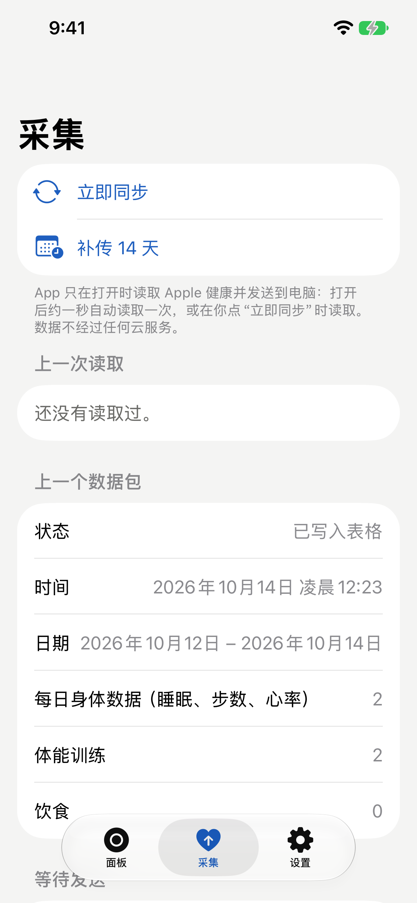
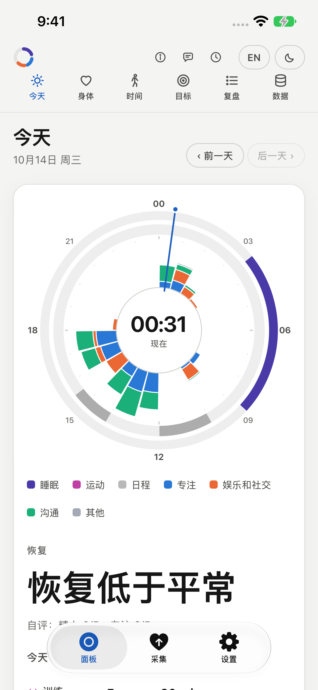
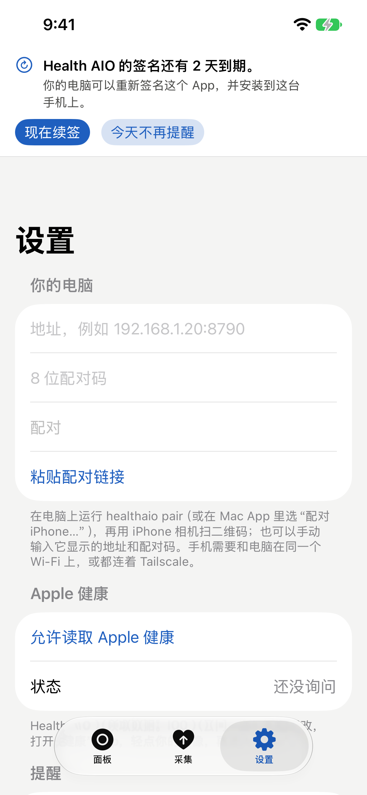

# Health AIO for iPhone · iPhone 端

[English](#english) · [中文](#中文)

<p>
  
  
  
</p>

## English

The iPhone companion of Proactive Health AIO. It reads Apple Health (read only) while it is open and sends it to
`healthaio serve` on your own computer over your home network or Tailscale; no cloud service is involved. It also
shows your dashboard in its **Panel** tab, and reminds you before the app's signature runs out. How the phone and the
computer talk is in [docs/CAPTURE.md](../docs/CAPTURE.md).

### Build and install

You need a Mac with Xcode 16 or newer, an iPhone with iOS 17 or newer, and an Apple ID.

1. Copy `ios/Local.example.xcconfig` to `ios/Local.xcconfig` and fill in a bundle id of your own (for example
   `com.yourname.healthaio`) and your Team ID (Xcode > Settings > Accounts). `Local.xcconfig` stays out of git.
2. Open `ios/HealthAIO.xcodeproj`, plug in the iPhone (or pair it over Wi-Fi), pick it as the run destination and
   press Run. The first time, allow the developer profile on the phone under Settings > General > VPN & Device
   Management.
3. On the computer run `healthaio serve --lan`, then `healthaio pair`, and point the iPhone Camera at the QR code
   (or type the address and the 8-digit code in the app's Settings tab).

**Free Apple ID or paid account.** A free Apple ID ("Personal Team") signs the app for 7 days; after that iOS will not
open it until it is signed again. A paid developer account signs it for a year. Either way the app checks once a day
and, two days before the end, shows a banner and posts a notification.

**Renewing.** Tap **Renew now** in the banner: the computer builds the app from this repository and installs it on
the paired iPhone (iOS closes the app once while the new copy goes in). The same from a terminal:

```sh
healthaio iphone renew
```

The Mac must be logged in at the desktop: from an SSH session the keychain is locked and signing fails. Updating the
computer first (`healthaio update`) and then renewing installs the new version of the app as well.

### Develop

```sh
xcodebuild test -project ios/HealthAIO.xcodeproj -scheme HealthAIO \
  -destination 'platform=iOS Simulator,name=iPhone 17e'
```

The tests read the shared example package `tests/fixtures/capture/health_3days.json`. Debug builds accept a few launch
arguments for screenshots and checks without a phone (see `HealthAIO/Support/DebugOptions.swift`), for example
`-HealthAIODebugServer http://127.0.0.1:8790 -HealthAIODebugPairCode 12345678 -HealthAIODebugSendSample YES`.
`python3 ios/tools/make_icon.py` redraws the app icon.

## 中文

Proactive Health AIO 的 iPhone 端。App 打开时以只读方式读取 Apple 健康，通过家里的网络或 Tailscale 发送到你自己电脑上的
`healthaio serve`，不经过任何云服务。**面板**标签页显示你的面板；签名快到期时会提醒你。手机和电脑之间怎么通信，见
[docs/CAPTURE.md](../docs/CAPTURE.md)。

### 编译和安装

需要一台装有 Xcode 16 或更新版本的 Mac、一台 iOS 17 或更新版本的 iPhone，以及一个 Apple ID。

1. 把 `ios/Local.example.xcconfig` 复制为 `ios/Local.xcconfig`，填上你自己的 bundle id（例如
   `com.yourname.healthaio`）和 Team ID（Xcode > 设置 > 账户）。`Local.xcconfig` 不会进入 git。
2. 打开 `ios/HealthAIO.xcodeproj`，用数据线连上 iPhone（或通过 Wi-Fi 配对），选它作为运行目标，点运行。第一次要在
   手机的“设置 > 通用 > VPN 与设备管理”里信任开发者。
3. 在电脑上运行 `healthaio serve --lan`，再运行 `healthaio pair`，用 iPhone 相机扫二维码（也可以在 App 的“设置”
   标签页手动输入地址和 8 位配对码）。

**免费 Apple ID 还是付费账号。** 免费 Apple ID（“个人团队”）签名的 App 能用 7 天，之后 iOS 不再打开它，直到重新签名；
付费开发者账号能用一年。两种情况下 App 都会每天检查一次，到期前两天显示横幅并发通知。

**续签。** 点横幅里的**现在续签**：电脑会用这个仓库重新编译 App 并安装到已配对的 iPhone 上（装新版本时 iOS 会关闭一次
App）。也可以在终端里运行：

```sh
healthaio iphone renew
```

Mac 需要在桌面上登录着：从 SSH 会话里钥匙串是锁着的，签名会失败。先更新电脑（`healthaio update`）再续签，
App 也会一起更新到新版本。

### 开发

```sh
xcodebuild test -project ios/HealthAIO.xcodeproj -scheme HealthAIO \
  -destination 'platform=iOS Simulator,name=iPhone 17e'
```

测试读取共享的示例数据包 `tests/fixtures/capture/health_3days.json`。Debug 版本支持几个启动参数，方便在没有手机时截图
和检查（见 `HealthAIO/Support/DebugOptions.swift`），例如
`-HealthAIODebugServer http://127.0.0.1:8790 -HealthAIODebugPairCode 12345678 -HealthAIODebugSendSample YES`。
`python3 ios/tools/make_icon.py` 重新画 App 图标。
